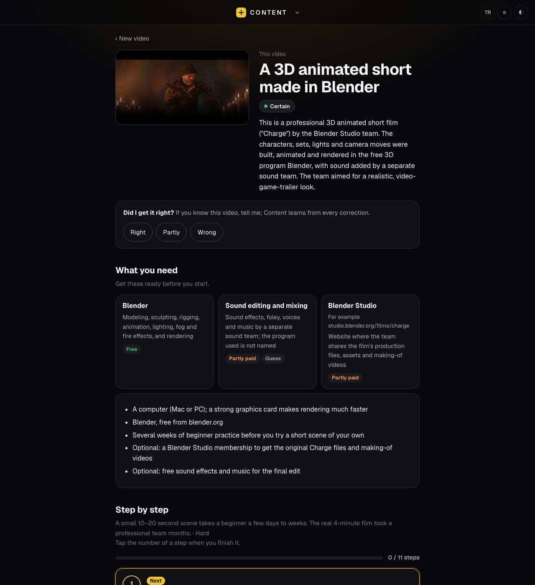

# Content

**Paste a viral video. Find out how it was made.**

You scroll past a Reel where a footballer suddenly scores in a different world, or a TikTok where a photo of someone's grandmother starts
dancing, and you think: *how did they do that?* Was it a CapCut template? Which AI model? A green screen? Three apps chained together?

Content watches the video for you, collects the evidence, and tells you, in plain language, how it was made and how you can make your own.
No guessing dressed up as certainty: every claim comes with how sure it is and what it is based on.



<sub>Screenshot: the analysis of <i>CHARGE</i>, a Blender Open Movie (© Blender Foundation, studio.blender.org, CC BY 4.0).</sub>

## Who it is for

- **Social media managers and agency creatives** who need to answer "can we do this for our brand by Friday?" in five minutes, not two hours.
- **Creators** who want to jump on a trend while it is still a trend.
- **Anyone curious** about the tools behind the videos they watch, without learning video editing jargon first.

## What you get

Paste a TikTok, Instagram Reel, YouTube Short (or any public video link yt-dlp can open) and, optionally, say what you want:
*"on my phone"*, *"with my own photo"*, *"for my brand"*, *"free tools only"*.

A few minutes later:

- **The method, in one line:** CapCut template · CapCut by hand · AI video tool · filmed and edited · screen recording · a mix.
- **How sure it is:** *Certain* / *Very likely* / *Best guess*, and for every tool named, what that rests on: the platform's own page,
  the creator saying so, a watermark, a tutorial for the same trend, comments, or only the pictures.
- **What you need:** the app or model (with the current name and whether it is free), the template link if there is one, and the kind of
  photo or footage to prepare.
- **Step by step:** numbered steps with the real menu names, written for someone who has never opened the app. Tick them off as you go.
- **If you get stuck:** the mistakes people usually make with this kind of video.
- **What happens in the video, scene by scene,** and the original moment if the trend remixes a real clip.
- **"Do it for me":** if the steps can be done on a Mac, a ready prompt to give Claude so it can carry them out with computer use.
- **"Was I right?":** tell it what it got wrong. It rewrites the guide with your correction and keeps a short lesson so the next analysis
  does better.

## How it figures it out

Content does not look at a few frames and guess. It stacks evidence from the strongest kind to the weakest:

1. **The platform's own page:** on TikTok, the "CapCut · Try this template" link, the template's name, how many photo slots it has and how
   many people used it; the sound, effects and AI labels.
2. **Tutorials:** it searches YouTube for people teaching the same trend and reads their descriptions and captions, so menu names and
   settings come from someone who actually did it.
3. **The trend on the web:** Claude searches for pages that explain the trend (by song name and TikTok's suggested searches).
4. **The file itself:** watermarks and end cards in the first and last frames, file tags, resolution, frame rate and clip lengths that match
   known AI tools (Veo's 8-second shots, Sora's odd sizes...).
5. **The pictures:** every cut is detected and each scene is sampled densely, so motion is visible, not just a still.
6. *(optional)* **Comments,** where people ask "what app is this?" and the creator sometimes answers.
7. *(optional)* **The song,** recognised from the audio with Shazam.

A second pass then checks the draft against the evidence: tools without proof are downgraded, menu names it is not sure of are made
general, missing steps are added. What it could not find is listed as such.

## Install

Requirements: a Mac with Apple silicon, macOS 14 or newer, [Homebrew](https://brew.sh), and a Claude subscription with
[Claude Code](https://claude.com/claude-code) signed in once (`claude auth login`). Content uses your own Claude account to look at the
frames and write the guide; there is no separate API key and no extra cost beyond your plan's usage.

```bash
git clone https://github.com/yehsohimself/content.git
cd content
./kurulum.sh
.venv/bin/python content_sunucu.py
```

Open http://127.0.0.1:8769. Next time, double-click `Content.command`. The install script adds `ffmpeg`, `deno` and `uv` with Homebrew
and creates `.venv` with the Python packages. The speech model (~1.6 GB) downloads the first time a video has speech.
For song recognition, run `./kurulum.sh --shazam` once and turn it on in Settings (the gear in the top bar).

## Where your data goes

- **Stays on your Mac:** the downloaded video, frames, speech-to-text (mlx-whisper), on-screen text (Apple Vision), all results and your
  corrections (in `content/`).
- **Sent to Claude, through your own account:** the frames, the transcript of the speech, the video's public description and the evidence
  above, to write the analysis. Claude may search the web for the trend.
- **Read from public pages:** the video page (via yt-dlp and, on TikTok, the public page data), CapCut template pages, YouTube search, and a
  public list of current AI video model names (api.sunra.ai, once a day; can be turned off).
- **Off until you turn them on** (Settings, the gear in the top bar): reading TikTok comments; recognising the song with Shazam (sends an
  audio fingerprint to Shazam); using your browser session for videos that need a login.

Content only reads public videos and never posts, likes or follows anything. It runs only on your Mac (127.0.0.1) and does not open a port
to your network.

## Known limits

- It explains how a video was made; it does not make the video for you.
- If a video carries no trace (no template link, no watermark, no one explaining it), the exact AI model behind it often cannot be known.
  Content will say "best guess" and tell you why.
- Instagram shows less than TikTok: no template links on the page, so Instagram results lean more on tutorials and pictures.
- Platform pages change. If TikTok changes its page, the strongest evidence disappears until Content is updated; it keeps working with
  the rest.
- macOS on Apple silicon only (mlx-whisper, Apple Vision).
- Code identifiers and comments are in Turkish; the interface and the guides are in English or Turkish (TR/EN button in the top bar;
  by default it follows your browser language).

## Tested on

MacBook Air M4, 16 GB, macOS 26.6, Claude Code signed in. A set of videos with known answers (CapCut templates, Veo, Sora, Viggle and
Meta AI videos with the creator's own label hidden, real footage that must not be called AI) is run after every change; see
`content_test.py`.

## Use it fairly

Content downloads a public video once to analyse it on your machine and keeps it in `content/`. Use it to learn and to make your own
version, not to re-upload someone else's work. Respect the terms of the platforms you analyse.

## Development

`content_sunucu.py` is a small Flask app; the analysis lives in `content.py` (download, scenes, speech, frames), `content_kanit.py` (evidence),
`content_yontem.py` (method and guide), `content_araclar.py` (traces that AI video tools leave) and `content_dogrulama.py` ("Was I right?").
Tests: `.venv/bin/python -m pytest tests -q`. `content_test.py` runs a set of videos with known answers and reports what the analysis
missed; add your own to `content/test_seti.json`. `python sizinti.py` checks the repo for personal data before every commit.

Issues and pull requests are welcome. If an analysis was wrong, include the link and what the right answer was.

MIT license. Content is a sibling of [Studio](https://github.com/yehsohimself/studio) (transcripts, subtitles, clips and dubbing on your Mac).

---

**Türkçe:** Viral bir videonun linkini yapıştırın; Content videonun nasıl yapıldığını (CapCut şablonu mu, hangi yapay zekâ aracı, nasıl
çekilmiş) kanıtlarıyla bulur ve kendi versiyonunuzu yapmanız için adım adım rehber yazar. Mac'inizde çalışır; çözümleme için kendi Claude
hesabınız gerekir. Arayüz ve rehberler Türkçe ya da İngilizce.
